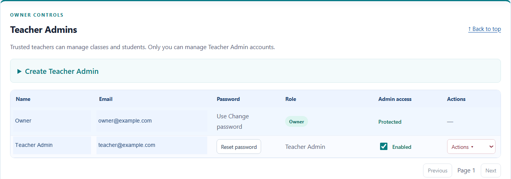
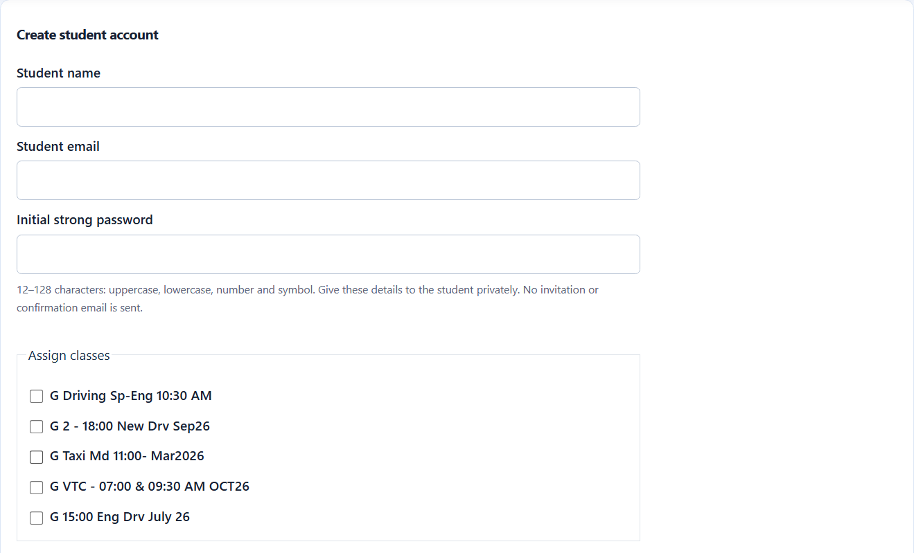
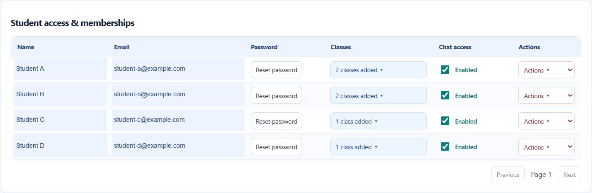
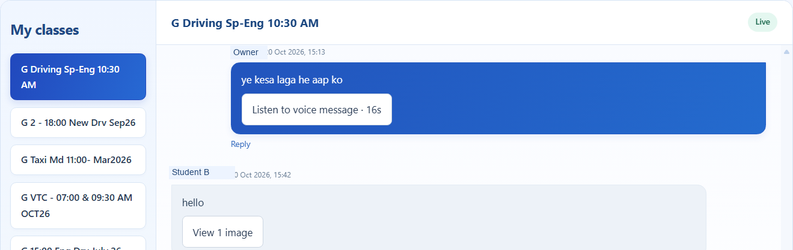
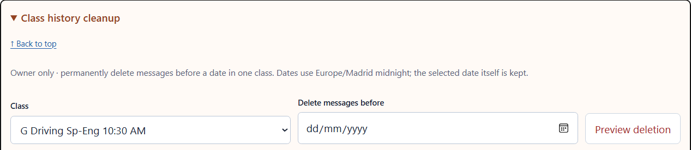
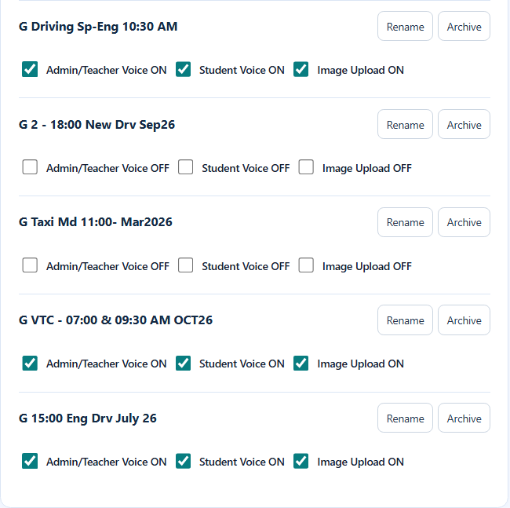
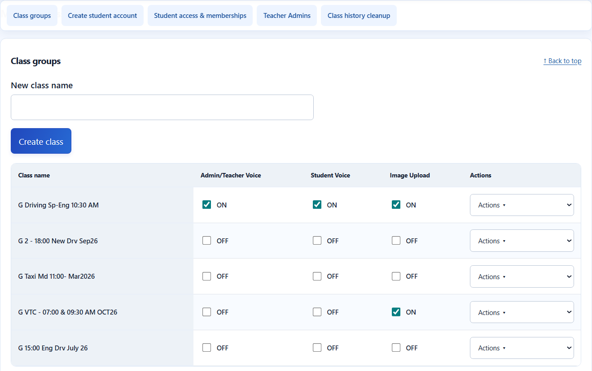
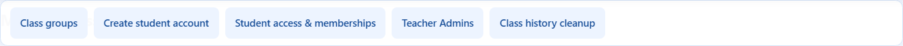

# Building a Private Classroom Chat with Codex and Supabase

**A practical AL-NOOR case study: delegated administration, database-enforced permissions, voice notes, images, and a user interface shaped by real classroom work.**

*By Muhammad Naveed Ishaque · Built collaboratively with OpenAI Codex*

A teacher creates a class, adds a student, and receives the first message. That sounds like a small feature. The engineering becomes more interesting when the next questions arrive:

Who can create another teacher administrator? Does removing a student from one class also block their login? What happens to the conversation after a student graduates? Can students upload voice notes when teachers have disabled them? And how does an administrator manage five classes without scrolling through a wall of repeated controls?

Those questions shaped the AL-NOOR Student Chat project. We extended an existing website into a private classroom communication system, using a plain HTML/CSS/JavaScript frontend and Supabase for authentication, PostgreSQL, realtime updates, private file storage, and server-side functions.

This is an implementation case study, rather than a claim that AI generated a complete, independently audited messaging platform in one prompt. I supplied the classroom workflows, reviewed the interface, tested the deployed system, and returned screenshots. Codex translated those requirements into code, migrations, permission checks, tests, and deployment instructions. Each round of actual use informed the next change.

> **The central design rule:** the interface should make permission choices understandable; the backend must enforce those choices even when the interface is bypassed.

## 1. Start with the existing website

The goal was to add a focused student chat area while retaining the existing website, inquiry flow, navigation, and other features. We did not introduce a new frontend framework or a separate always-running application server for chat.

The resulting system supports private classes, text messages, replies, teacher announcements, Google Meet links, account management, voice notes, and image attachments. Meet links remain ordinary links: this project does not implement video calling, audio calling, or transcription.

The main components are:

| Component | Responsibility |
| --- | --- |
| HTML, CSS, and JavaScript modules | Chat interface, previews, account forms, tables, and navigation |
| Supabase Auth | User identity and password authentication |
| PostgreSQL | Profiles, classes, memberships, messages, settings, and audit records |
| Row Level Security and SQL functions | Restrict reads and control database operations |
| Supabase Realtime | Notify authorized clients about new messages |
| Supabase Edge Functions | Privileged account operations, media validation, and administrative actions |
| Private Supabase Storage | Image and audio files, separate from message metadata |

```text
Browser
  ├─ Auth → identity and session
  ├─ Database reads → grants + Row Level Security
  ├─ Text message → authenticated SQL function
  ├─ Realtime → new-message subscription + history fetch
  └─ Admin/media request → Edge Function validates identity and permissions
                              ├─ PostgreSQL transaction
                              └─ Private Storage
```

The distinction between text and media writes matters. Text goes through a controlled database function. Media goes through an Edge Function first because its actual file contents must be inspected before publication.

## 2. Separate ownership from teaching responsibilities

The everyday requirement was simple: a trusted teacher should be able to manage classes and students without receiving the power to appoint another administrator or remove the owner.

We used two stored profile roles, `admin` and `student`, plus a separately protected Owner identity. Owner is a protected application identity, not a third freely assignable profile-role string.

| Capability | Student | Teacher Admin | Owner |
| --- | :---: | :---: | :---: |
| Read and send in an accessible active class | Yes | Yes | Yes |
| Create, rename, archive, or reopen classes | No | Yes | Yes |
| Create and manage student accounts | No | Yes | Yes |
| Change per-class media settings | No | Yes | Yes |
| Create or manage Teacher Admin accounts | No | No | Yes |
| Permanently delete an entire class | No | No | Yes |
| Delete class history before a cutoff date | No | No | Yes |

Students need current membership in the class. Active admins can access classes across the application; the current model does not restrict each teacher to only their own classes. Teacher rights remain until revoked. They are not a daily permission that the owner needs to grant again each morning.

The Owner identity is held in a private database structure, and a database trigger protects the Owner profile from deletion, deactivation, or demotion through ordinary application operations. The backend determines ownership from the authenticated identity; it does not accept an `is_owner` flag supplied by a browser.



*Figure 1 — Delegation without transferring application ownership. Names and emails have been replaced with example labels for publication.*

This protection applies within the application. A person with project-owner or database-superuser access still has infrastructure-level authority. Application roles are not a substitute for protecting the underlying Supabase account.

## 3. Treat login access and class membership as different decisions

One early test exposed an important distinction. Removing a student from one class left their account available, which was correct. Revoking all chat access also stopped their ability to use the chat login, which was a different operation.

The interface needed to explain that difference rather than treating every removal as the same action.

The student lifecycle now has separate operations:

- **Membership change:** add or remove access to selected classes.
- **Access revoke/restore:** disable or re-enable use of the chat account.
- **Password reset:** assign a new temporary password and require a change before chat access.
- **Account deletion:** permanently remove the account while preserving the conversation under a former-member label.

Administrators create accounts with an initial password. Accounts are confirmed through the administrative API without sending an invitation email. The initial-password-change gate applies to normal chat access and privileged actions, not merely to whether a form is visible.



*Figure 2 — Account creation combines identity details with explicit class assignment.*

The table displays **Reset password**, rather than revealing a student's existing password. Administrators can replace a password; the application does not retrieve or display the current one. Initial credentials must be shared privately.

A checkbox-based class picker shows a compact count such as “2 classes added.” Checking a class adds membership; unchecking it removes membership. The count summarizes the result without repeating a long button for every class.



*Figure 3 — Each student occupies one row, with separate controls for credentials, memberships, access, and account actions.*

## 4. Put authorization below the buttons

Hiding an administrative button makes an interface easier to understand. It does not stop someone from constructing the request manually.

The implementation therefore checks access at several boundaries:

1. Authentication identifies the caller.
2. The current profile establishes whether the account is active and whether its initial password still needs changing.
3. The requested operation checks role, ownership, or class membership as appropriate.
4. Database grants, RLS policies, and controlled SQL functions restrict the underlying operation.

For example, the text-send function derives the sender from `auth.uid()`, checks access to the class, restricts announcements to administrators, validates the text length, and applies a two-second per-sender interval. A browser cannot choose a different sender name or author identity through that function.

The policy model follows the database-enforced authorization approach described in the [Supabase RLS documentation](https://supabase.com/docs/guides/database/postgres/row-level-security). Privileged operations use server-held credentials; those credentials must never be included in frontend code.

Some Edge Function deployments use `--no-verify-jwt`. Here, that flag does **not** make the implemented handlers anonymous: the shared handler code reads the bearer token, validates it using Auth, and loads the current application profile. The important point is to inspect the actual authorization path, rather than inferring safety from a deployment flag alone.

This is authenticated private chat, not an end-to-end encrypted messaging system. Authorized project infrastructure can access the stored content.

## 5. Make voice and image permissions explicit

Media increased the number of decisions each teacher needed to make. One shared voice switch would not meet the requirement: a class might allow teachers to record explanations while keeping student replies text-only.

Each class therefore has three independent settings:

| Setting | Applies to | Default |
| --- | --- | --- |
| Admin/Teacher Voice | Owner and Teacher Admin recording uploads | OFF |
| Student Voice | Student recording uploads | OFF |
| Image Upload | Image uploads by authorized admins and class members | OFF |

The current starting limits are one voice note up to **2 minutes**, or up to **5 images** in one message. The composer explains these limits in plain English:

> You can record a voice message up to 2 minutes.
>
> You can select up to 5 images at a time.

Users can review images or listen to a recording before sending, remove unwanted media, and add an optional text caption. A message contains either one voice note or an image batch; it does not mix both attachment types.



*Figure 4 — Voice and image messages remain part of the existing class conversation. This screenshot shows attachment controls, not an assertion about the contents of an unopened attachment.*

### The media publication path

```text
Select images / record voice
        ↓
Prepare local preview and optimized file
        ↓
Send authenticated multipart request
        ↓
Validate account + class + media setting
        ↓
Inspect and normalize actual file bytes
        ↓
Reserve cleanup record + upload private object
        ↓
Transactional permission recheck + publish message references
```

Images selected as JPG, PNG, or WebP are resized in the browser to a maximum 2048-pixel side and converted to JPEG. The server independently decodes and re-encodes the JPEG, strips metadata, and applies a 2 MiB per-image limit. A filename or declared MIME type alone is insufficient evidence of a valid image.

Voice recordings are normalized to mono, 16 kHz, 16-bit PCM WAV. The server checks the WAV structure and derives the duration from the actual audio data. A two-minute recording is approximately 3.84 MB.

That is a deliberate tradeoff: PCM allows straightforward duration validation without introducing another media service, but it uses more space than compressed voice messaging. This implementation should not be described as matching WhatsApp's codec efficiency.

PostgreSQL stores file paths and metadata, not the audio/image binary payloads. Objects live in the private `alnoor-chat-media` bucket. Browser uploads are not allowed directly; the backend chooses random paths and uploads without overwriting existing objects.

Playback and image retrieval use authenticated Storage downloads. The read policy checks that the object is referenced by an accessible class message. This uses the policy-based access mechanism documented in [Supabase Storage access control](https://supabase.com/docs/guides/storage/security/access-control).

Turning a media switch OFF blocks new uploads. It does not erase existing attachments. Membership removal or account revocation blocks future authorized downloads, although content already downloaded or copied cannot be recalled.

## 6. Separate graduation, archiving, and deletion

A student leaving a course should not break the conversation for everyone else. We separated four different actions:

| Action | Account | Class | Existing conversation |
| --- | --- | --- | --- |
| Remove a class membership | Retained | Retained | Retained for other authorized users |
| Delete student account | Removed | Retained | Retained under “Former student” |
| Archive class | Retained | Retained but inactive | Preserved; normal class chat is blocked |
| Delete class | Retained | Removed | Permanently removed for that class |

Teacher account deletion similarly preserves old messages under “Former teacher.” Anonymizing the author label does not remove personal details someone typed into the message body.

Destructive account and class actions sit inside an **Actions** dropdown. They open a confirmation dialog and require the operator to type `DELETE`. Account deletion checks the current account email; whole-class deletion previews the class name, message count, and membership count.

For class deletion, the SQL function locks the class and rechecks the preview values before deleting its history and memberships. The audit record commits with the database deletion. A changed preview is rejected rather than silently applying a stale confirmation.

Whole-class deletion is Owner-only. Teacher Admins can still archive or reopen a class as part of ordinary management.

### History cleanup is another separate operation

The Owner can delete messages before a selected date in one class. The cutoff is **midnight in Europe/Madrid**; messages on the selected date and later are retained.

The preview shows the target class, cutoff, and number of messages. Execution checks the preview count and history revision. If a surviving reply points to a deleted original, it remains visible with an “Original message deleted” label.



*Figure 5 — A preview precedes permanent history cleanup. This is a manual Owner action, not an automatic retention schedule.*

File storage and PostgreSQL do not share one atomic transaction. Deleting message records therefore queues associated objects for physical cleanup. Access through the message reference ends when the reference is removed; physical file deletion can be retried separately.

Cleanup processes up to 100 files per batch. Due cleanup runs during media sends, history cleanup, or an explicit Owner retry. Interrupted upload reservations become eligible after one hour. There is no background scheduler guaranteeing immediate removal of every orphaned object.

## 7. Let real screenshots drive interface improvements

The first media-management layout repeated a class name, Rename and Archive buttons, and three long permission labels for every class. It worked, but occupied too much vertical space as the class list grew.



*Figure 6 — The earlier layout made each class a small block of repeated controls.*

The next version gives each class one row. Column headings explain the settings once, while each row contains concise ON/OFF states and an Actions dropdown.



*Figure 7 — The revised table makes permission differences between classes easier to compare.*

This change came from using the system, not from adding more technical infrastructure. It also moved the class table to full width rather than squeezing five columns into half of the page.

A second usability issue appeared once management included several sections. Administrators needed quick navigation without repeatedly scrolling past the chat.

We added a sticky management bar beneath the main site menu. Owner accounts see five destinations; Teacher Admins see only the three relevant to their responsibilities. Students do not see the bar. Each destination has a Back to top link, and scroll offsets keep its heading clear of the fixed menus.



*Figure 8 — Management navigation appears when management is opened; mobile users can scroll the shortcuts horizontally.*

## 8. What Codex contributed—and what remained human work

The useful collaboration pattern was a sequence of bounded changes:

**Describe the classroom problem → implement the smallest complete behavior → test denied and allowed paths → review screenshots → deploy → refine from use.**

Codex contributed frontend modules, SQL migrations, database policies and functions, administrative handlers, media validation, browser checks, security tests, and installation documentation. It also helped turn visual feedback into concrete changes, such as compact membership controls and the full-width class table.

My contribution was the operating context: how teachers should be delegated authority, what happens when students graduate, which controls were confusing, how much scrolling was acceptable, and when an implementation was ready to try with real accounts. I ran the hosted deployment commands and reported what actually happened.

The screenshots and deployment outputs are evidence of working flows. They are not proof that every security property has been independently audited. The strongest part of the process was making important claims testable rather than relying on confident descriptions.

## 9. Verification: distinguish tests from production experience

The accumulated local verification includes:

| Evidence | Recorded result | What it establishes |
| --- | --- | --- |
| Node handler/security suite | 80 passing tests | Role checks, account operations, media limits, and failure handling with mocked service responses |
| PostgreSQL security checks | 75 passing assertions across successive feature suites | Database behavior including access denial, deletion boundaries, retained accounts, and cleanup queues |
| Additional real JPEG-codec handler run | 15 passing cases | Exercises the actual codec alongside handler checks |
| Existing inquiry API tests | 7 passing tests | Regression coverage for an existing website feature |
| Browser checks | Desktop and narrow viewport scenarios | Tables, previews, recording preparation, shortcuts, confirmation, and role-specific interface visibility |
| Owner-provided live screenshots and reports | Working deployed flows reported | Class creation, student onboarding, delegated teaching, media messages, and final navigation in use |

The PostgreSQL tests used real PostgreSQL with minimal local Auth and Storage schema stubs. Browser suites used mock Supabase responses. A Chromium recording check captured microphone input from a test device and produced a WAV preview; it was not an on-device iPhone test.

The 75 database assertions combine 22 chat, 9 Owner, 19 account/history deletion, 11 media, and 14 class-deletion checks. These are recorded results across development stages, not a load-test score or proof of a new independent audit of the final hosted environment.

Negative tests were particularly valuable: a teacher attempting Owner operations, a removed member requesting media, HTML disguised as an image, a recording exceeding two minutes, six selected images, and a permission change before publication.

## 10. Deployment stayed incremental

Database changes were delivered as five ordered migrations: initial chat, protected Owner, account/history deletion, media, and class deletion. Existing records were preserved by installing these migrations; destructive user actions remained separate.

Backend deployments used the existing Supabase project. Frontend changes went through the existing Git publishing workflow. No calling service, transcription service, or new continuously running chat server was introduced.

Two practical deployment issues also became part of the documentation: using `npx.cmd` when PowerShell blocked the `.ps1` launcher, and running function deployment from the correct repository directory so the entrypoint existed.

The general release order was: apply the required migration, deploy the changed function, publish frontend files, refresh the page, and verify the hosted flow with a disposable class or account.

## 11. What I would evaluate next

The implemented scope is useful, but there are clear next engineering questions: compressed audio formats, storage quotas, scheduled orphan cleanup, sustained traffic and storage-load tests, wider physical-device testing, and independent security review. Teacher-scoped administration would require an additional permission model if the organization wanted teachers to manage only their own classes.

Realtime disconnect indicators and reconnect behavior also deserve observation under unreliable mobile networks. Responsive layout tests should not be mistaken for a complete mobile-device compatibility program.

The lesson from this project is practical: AI-assisted development becomes more credible when the human workflow is explicit, authorization is enforced below the interface, and each new capability comes with evidence and an honest account of its limits.

AL-NOOR started with a request for student chat. The result grew through the questions that appeared when teachers and students actually used it—and through making those questions part of the engineering process.

---

**Implementation references:** [Supabase RLS](https://supabase.com/docs/guides/database/postgres/row-level-security), [Storage access control](https://supabase.com/docs/guides/storage/security/access-control), and [Edge Functions](https://supabase.com/docs/guides/functions).

**Screenshot note:** Images are cropped from the project owner's supplied screenshots. Where accounts are visible, names and email addresses have been replaced with neutral example labels. The earlier and revised layouts are identified explicitly. Images were not generated as mock product evidence.
